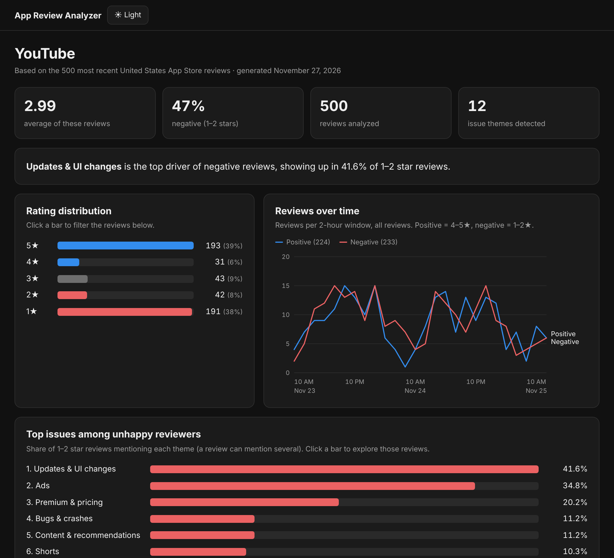

# App Review Analyzer

Pick any App Store app and see what's frustrating its users most: themes ranked by how often they show up in negative reviews, trends over time, and every review searchable, with real quotes as evidence.



## Why I built this

At work I spend a lot of time figuring out what's actually causing customer friction, using analytics, customer feedback, and QA findings. App Store reviews are one of the most direct sources of that feedback, but nobody reads 500 of them. I wanted a tool that would read them for me, group the complaints into themes, and tell me which problems matter most.

## What it found for YouTube

Running it on the 500 most recent US reviews of the YouTube app:

- **Users are polarized.** 39% gave 5 stars and 38% gave 1 star, with very little in between.
- **Recent changes are the #1 complaint.** "Updates & UI changes" shows up in about 42% of negative reviews, ahead of ads (35%). Reviewers called out specific things, like a removed subscriptions filter and a smaller skip-ad button.
- **Pricing frustration is tied to ads.** Many Premium complaints are really about feeling pushed toward paying to escape ads.

## How it works

The main way to use it is the interactive app: run `python3 app.py` and a dashboard opens in your browser. Search for any App Store app (or pick a popular one), choose a country, and it pulls that app's most recent reviews and analyzes them on the spot.

1. **Collect** (`fetch_reviews.py`) pulls up to 500 of an app's most recent reviews from Apple's public review feed, including rating, text, app version, and date. Apple's feed randomly returns empty pages, so it fetches pages in parallel and retries the empty ones.
2. **Analyze** (`analyze.py`) tags each review with themes using a keyword taxonomy, then ranks the themes by how often they appear in 1–2 star reviews. It also flags negative reviews that didn't match any theme, so the taxonomy can be improved over time.
3. **Show** (`app.py` and `report.py`). `app.py` is a small local web server (standard library only) that serves the dashboard and fetches apps on demand. `report.py` holds the dashboard page and can also write a single self-contained `report.html` you can share. The dashboard has headline stats, the rating split, ranked issues, reviews over time split into positive and negative, example quotes, and a searchable explorer of every tagged review. Click an issue or rating bar to filter the explorer, filter by rating, theme, or app version, and hover the charts for details. It opens in dark mode, with a light/dark toggle.

## Design decisions

- **Themes live in a config file, not in code.** `themes.json` holds the full taxonomy, so anyone can adapt it to a new app or add a theme without touching the code.
- **No AI.** Keyword tagging is free, fast, and fully transparent. You can see exactly why a review got tagged. The tradeoff is that it misses sarcasm and anything phrased in an unexpected way.
- **Ranked by unhappy users.** Themes are ranked by how often they show up in negative reviews, not overall, because the goal is to find what to fix.
- **The tool reports its own blind spots.** The "gaps" section lists common words in untagged negative reviews. That's how I found that "change" was missing from the Updates theme.

## Run it yourself

You need Python 3 and an internet connection. Nothing else to install.

```bash
python3 app.py
```

Your browser opens at http://localhost:8000. Search for an app and click it. Keep the terminal window open while you use the app, and press Ctrl+C there to stop it.

Other ways to run it:

```bash
python3 report.py              # build report.html from the saved YouTube reviews in reviews.json
python3 report.py 570060128    # fetch an app by its App Store ID (here Duolingo) and build report.html for it
python3 fetch_reviews.py 570060128   # just save an app's reviews to reviews.json
python3 analyze.py             # print the theme ranking for reviews.json
```

An app's ID is the number after `id` in its App Store URL. You can also download any app's report from the dashboard with the **Download report** button. The theme keywords live in `themes.json`; edit them to add themes or tune them for a particular app.

## What I'd add next

- Support for Google Play reviews
- Longer-range trends by app version, to spot when a release caused a spike in complaints
- Handling non-English reviews (several Spanish reviews currently go untagged)
- An optional AI mode for more nuanced grouping
